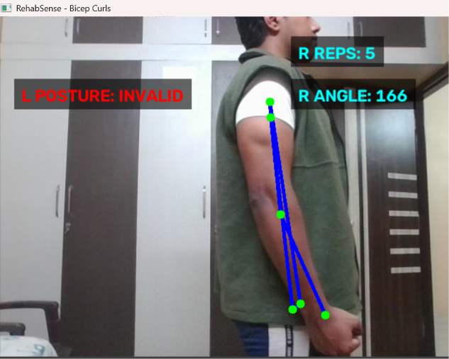
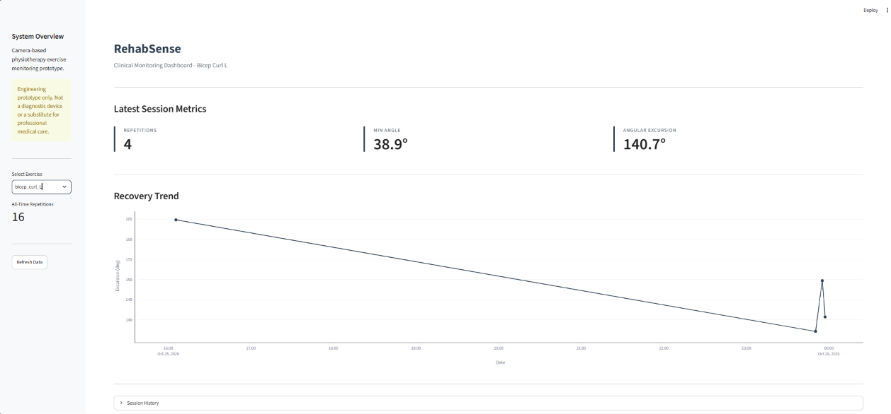

# RehabSense

A camera-based physiotherapy exercise monitoring and recovery-trend prototype that uses a standard webcam to quantify rehabilitation movements.

## Problem
Home rehabilitation exercises are difficult to monitor objectively between supervised sessions. Patients often perform exercises with poor form or incorrect volume, and clinicians lack quantitative data on adherence and progress. 

## Proposed Solution
RehabSense uses an ordinary webcam to estimate pose landmarks during selected knee and arm rehabilitation exercises. It converts body landmarks into interpretable joint-angle metrics, counts repetitions using a state machine, and visualizes longitudinal recovery progress. 

## Key Features
- **Real-time Pose Estimation:** Uses MediaPipe Tasks API to track body landmarks.
- **Biomechanical Posture Validation:** Rejects invalid movements and occluded limbs.
- **State Machine Rep Counting:** Accurately counts reps with temporal smoothing to reduce AI jitter.
- **Clinical Dashboard:** Streamlit-based UI to track range of motion (ROM) over time.
- **Data Persistence:** Saves session metrics locally to a CSV.

## Technical Challenges & Engineering Solutions
During development, several computer vision and biomechanical edge cases were identified and solved:

- **Occlusion Hallucination:** When performing a single-arm curl, the body blocks the opposite limb. MediaPipe would hallucinate fake joints, causing erratic lines and false reps. 
  - *Solution:* Implemented a strict visibility gate (confidence > 0.6). If a joint is obscured, its lines are hidden and calculations are paused until it re-enters the frame.
- **Temporal Jitter:** Rapid arm or knee movements caused frame-by-frame angle spikes (e.g., glitching to 0° for a single frame).
  - *Solution:* Added a rolling 5-frame average (deque buffer) to smooth the angle output before it reaches the state machine.
- **Invalid Posture Counting:** Curling the arm horizontally (like a zombie) still triggered the elbow-angle state machine.
  - *Solution:* Added a biomechanical check requiring the elbow to stay below the shoulder and the upper arm to remain roughly vertical.

## Tech Stack
Python 3.14, OpenCV, MediaPipe, Pandas, Streamlit, Plotly, pytest.

## Placement & Camera Alignment
For accurate 2D joint-angle estimation, the user must stand **side-on (profile) to the camera** for exercises like squats and bicep curls. Standing face-on causes depth flattening, which distorts the 2D projection of the joint angle. Ensure your full body or upper body is visible in the frame depending on the exercise you are targetting. 

## How to Run Locally
1. Clone the repository:
   git clone https://github.com/shahan-cyber9/rehabsense.git
   cd rehabsense
2. Create and activate a virtual environment:
   python -m venv .venv
   .\.venv\Scripts\activate
3. Install dependencies:
   pip install -r requirements.txt
4. Download the MediaPipe model (`pose_landmarker_lite.task`) and place it in a `models/` folder.
5. Run the app:
   streamlit run app.py

## Visuals
### Live Pose Tracking

### Clinical Dashboard

## Safety Disclaimer
This is an engineering/research prototype only. It is not a diagnostic medical device and must not be used for diagnosis, treatment decisions, or assessment of rehabilitation readiness.